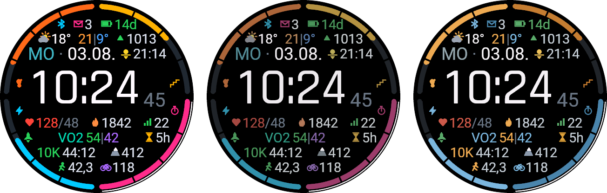
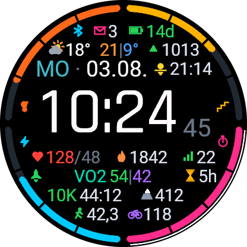
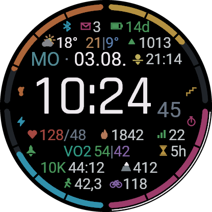
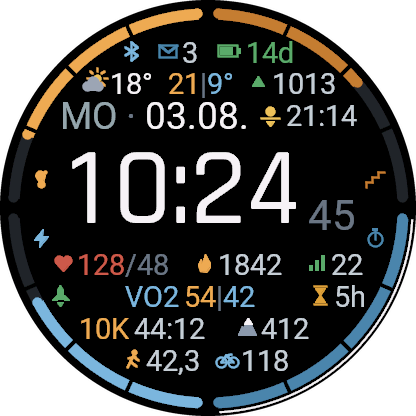

# Beni Watchface

A watch face for the **Garmin fēnix 8 43 mm**. All values at a glance, a calm
center, goals at the edge — German throughout and in 24-hour format, regardless of
what the watch is set to.



> The screenshots show **sample data**, not real measurements — the simulator
> delivers no sensor data, and a watch face full of `--` says nothing about the
> layout.

---

## Layout

The watch face is mirrored at the time: **above** it sits what comes from outside,
**below** it what the body reports. That replaces any divider line — after two
glances you know which half to look in.

| Row | Content |
|---|---|
| Status | Bluetooth · unread notifications · watch battery in remaining days |
| Weather | Conditions and temperature · forecast for tomorrow (high \| low) · air pressure with trend |
| Date | Weekday in the time-of-day color · date · **next** sunrise or sunset |
| **Time** | 24 h, seconds subscripted |
| A | Heart rate / resting heart rate · calories burned · stress |
| B | Training status (rocket) · VO₂max running \| cycling · remaining recovery time |
| C | Race prediction · current altitude |
| D | Weekly kilometers running · weekly kilometers cycling |

Four goal arcs run along the edge, each with a symbol next to it saying what it
stands for: **steps** (footprint), **floors** (stairs), **Body Battery** (bolt) and
**weekly active minutes** (stopwatch). A reached goal gets a white hairline on the
outside — visible in the left screenshot at the active minutes.

---

## Color schemes

Switchable on the watch, see [Configuration](#configuration).

| Full | Muted | Calm |
|:---:|:---:|:---:|
|  |  |  |
| Every metric has its own color, and it applies everywhere. | The same colors, just quieter: every tone moves 45 % toward *its own* grey and is darkened to 82 % brightness. | Twelve hues become five. Color no longer identifies the metric but its kind — warm amber for movement, cool blue for body and endurance. |

"Calm" can afford this because the ring has its legend symbols and every row carries
its own icon: the **shape** says what it is about, color can limit itself to
grouping. Only the four ring sections and the split values `54|42` and `21|9°` keep
their distinction.

---

## Configuration

Everything is set **on the watch**, in the built-in watch face editor:

> Show the watch face → **long-press MENU** → *Edit watch face* → **Style**

There are twelve entries — every combination of color scheme and race distance:

| | 5 km | 10 km | HM | Marathon |
|---|---|---|---|---|
| **Full** | ✓ | ✓ *(default)* | ✓ | ✓ |
| **Muted** | ✓ | ✓ | ✓ | ✓ |
| **Calm** | ✓ | ✓ | ✓ | ✓ |

That it is one single list instead of two menus is dictated by Connect IQ:
**app settings cannot be edited on the watch at all.** Garmin's docs say it
literally — the framework is aimed at Garmin Connect and Garmin Express, "especially
for watch faces and data fields, *that have no way to receive user input on Garmin
devices*". The watch face editor (`WatchFaceConfig`, API 5.1.0) is the only route
that gets by without the store and without a phone — and it only knows one selection
list. So both multiply: 3 × 4 = 12.

The race prediction comes from Garmin's Race Predictor. There is no access to the
**race calendar** in Connect IQ — no API call returns the next planned race, which is
why you choose the distance yourself.

---

## Building and installing

```
monkeyc -f monkey.jungle -o bin/Beni_Watchface.prg -y developer_key_pkcs8.der -d fenix843mm -w
```

Copy the finished `bin/Beni_Watchface.prg` to the `GARMIN/APPS` folder of the watch,
eject the watch, unplug it — done.

If the project path contains a `!`, the SDK's `.bat` wrappers mangle it through
delayed expansion, so copy the `.prg` to a `!`-free path before `monkeydo`.

---

## Design

**[DESIGN.md](DESIGN.md)** is the actual specification: color system, geometry down
to the pixel, data sources, language rules — and for every decision, why it fell the
way it did, including the versions that didn't make it.
